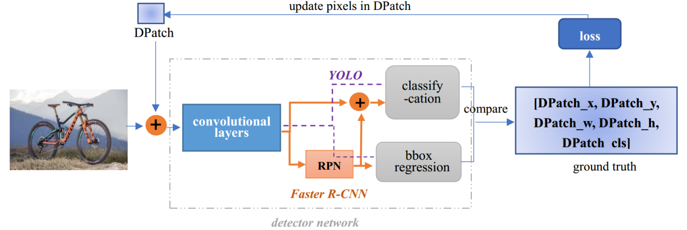

# 目标检测对抗贴片

## 一、题目简介

目标检测模型在现实部署中面临一种特殊的安全威胁——对抗贴片攻击：攻击者可以在目标物体表面粘贴一张经过精心优化的"对抗贴片"，使检测器对该目标漏检、类别误判或置信度显著下降，且同一张贴片可适用于大量不同图像（通用贴片）。本题围绕这一场景考查攻防两方面的能力：攻击方需要生成一张受尺寸约束、具有通用性与迁移性的对抗贴片，使统一目标检测模型对原本可检测目标的检测性能显著下降；防御方则不能修改目标检测模型，而是训练一个独立的贴片检测二分类器，在不知道攻击贴片内容与官方贴片添加方法的前提下，识别出含对抗贴片的图像。通过攻防双方的对抗与评测，考查对对抗贴片攻击原理、目标检测模型脆弱性以及未知贴片泛化检测的深入理解与实现能力。

## 二、算法原理

### 2.1 攻击方原理

攻击方的总体目标是：在给定的贴片尺寸约束（$32 \times 32 \times 3$，像素范围 $[0,1]$）内，生成一张**通用对抗贴片**（Universal Patch），由裁判程序统一将该贴片渲染（位置、缩放、旋转、颜色抖动）到隐藏测试图像的目标框内，再送入统一目标检测模型推理；若加入贴片后原本能够被正确检测的目标大量漏检、置信度显著下降或整体检测性能下降，则说明攻击成功。攻击方只能返回贴片本身，不能返回修改后的图像、贴片位置或缩放比例，且同一轮评测的所有测试样本必须使用同一张贴片。攻击方可以获取公开训练数据与公开检测模型 Model-A（白盒，可前向与反向传播），据此优化贴片；同时裁判端会使用与攻击贴片面积、位置、变换完全相同的普通非对抗贴片（灰块、黑块、白块、随机噪声、随机纹理）生成"自然遮挡基线"，攻击得分主要衡量攻击贴片相对于普通遮挡所额外造成的检测性能下降，避免"纯遮挡"获得过高分。

常见攻击思路可分为三类：**梯度优化白盒攻击**，利用公开检测器的梯度信息，通过可微渲染将贴片与检测器前向计算相连，最大化"隐藏目标"损失（代表方法：DPatch、EOT）；**黑盒与迁移攻击**，在不访问隐藏模型梯度的前提下通过多模型自集成、代理模型等提升迁移能力（代表方法：T-SEA）；**物理世界攻击**，考虑打印、光照、视角等物理变换，生成可打印贴片（代表方法：Thys 等针对 person 检测的贴片）。

**Baseline：梯度优化通用对抗贴片（GradientPatchAttack）**。该算法是梯度优化白盒类攻击中最具代表性的基线，代码接口为 `attack(env, task) -> {"patch": ndarray (3, 32, 32) float32 [0,1]}`：输入攻击环境 `env`（含公开检测器 Model-A 与可微渲染器）与任务 `task`（含攻击优化训练图像、目标框标注、目标类别），输出一张通用对抗贴片。其原理是：随机初始化贴片后，在每个优化迭代步中随机采样若干张训练图，对每个目标框随机采样渲染参数（EOT，Expectation over Transformation），通过可微渲染将贴片粘贴到图像上，送入检测器前向，计算"隐藏目标损失"与全变分（TV）正则之和作为目标函数，用 Adam 优化器更新贴片像素并裁剪到 $[0,1]$，迭代多轮得到通用贴片。实现步骤为：① 用固定随机种子（默认 42）将贴片初始化为 $(3,32,32)$ 均匀随机噪声；② 每步随机抽取 $8$ 张（`batch_size=8`）含目标类的训练图，每张图随机选一个目标框并采样渲染参数——贴片边长按目标框面积的 80%（`max_patch_area_ratio=0.80`）计算并施加 $[0.85,1.15]$ 缩放抖动、旋转角度 $\pm 15^\circ$、中心限制在目标框中央 60% 区域、颜色因子 $[0.9,1.1]$ 抖动；③ 用可微渲染（双线性采样网格 + 软掩膜）得到带梯度连接的渲染图；④ 计算隐藏目标损失 $L_{\text{hide}}$：一方面最小化目标框覆盖网格单元内 objectness logit 经 sigmoid 后的均值（压制检测置信度，非饱和、梯度恒定），另一方面以 2.0 的权重最大化预测框与真实框的 L1 距离（框回归破坏，使 IoU < 0.5），再加 TV 正则项

$$
L = \underbrace{\frac{1}{n}\sum_{i=1}^{n}\frac{1}{|\mathcal{C}_i|}\sum_{j\in\mathcal{C}_i}\sigma(o_{i,j})}_{\text{objectness 压制}} - \underbrace{\frac{2.0}{n}\sum_{i=1}^{n}\frac{1}{|\mathcal{C}_i|}\sum_{j\in\mathcal{C}_i}\left\| b_{i,j} - g_i \right\|_1}_{\text{框回归破坏}} + \lambda_{tv}\, TV(p)
$$

其中 $n$ 为批内目标数，$\mathcal{C}_i$ 为第 $i$ 个目标框内（中心落入框内）的网格单元集合，$o_{i,j}$、$b_{i,j}$ 分别为单元 $j$ 的 objectness logit 与预测框，$g_i$ 为真实框，$\sigma$ 为 sigmoid 函数；TV 正则项为

$$
TV(p) = \frac{1}{2HW}\sum_{c=1}^{3}\left(\sum_{h=1}^{H-1}\sum_{w=1}^{W}|p_{c,h+1,w}-p_{c,h,w}| + \sum_{h=1}^{H}\sum_{w=1}^{W-1}|p_{c,h,w+1}-p_{c,h,w}|\right)
$$

其中 $p$ 为贴片（$3 \times H \times W$，$H=W=32$），默认 $\lambda_{tv} = 0.01$；⑤ 反传梯度（NaN 梯度置零防发散）、Adam 更新（默认 `lr=0.01`）、贴片裁剪回 $[0,1]$；默认迭代 $250$ 步（`iters=250`）。优化完成后贴片经合法性检查（尺寸 $(3,32,32)$、数值有限、范围 $[0,1]$）后由裁判统一渲染评测。该算法为白盒攻击，每步计算复杂度为 $O(\text{batch} \times (\text{渲染} + \text{检测器前向/反传}))$，总复杂度 $O(\text{iters} \times \text{batch} \times C_{\text{det}})$（$C_{\text{det}}$ 为检测器单次前向反传开销）；EOT 与 TV 正则使其对贴片位置、缩放、旋转变化具有鲁棒性，不易过拟合单张图像，因此被广泛用作评估防御方法有效性的标准攻击基线。

<figure style="margin:10pt auto; text-align:center;">

<figcaption style="font-size:10pt; text-align:center; margin-top:4pt;">梯度优化通用对抗贴片（GradientPatchAttack）算法示意图</figcaption>
</figure>

另有三类非优化基线：**随机噪声贴片（RandomNoiseAttack，A0-1）**，直接返回 $(3,32,32)$ 均匀随机噪声，几乎没有真实攻击能力，仅验证接口；**棋盘纹理贴片（CheckerboardAttack，A0-2）**，生成随机双色棋盘高对比纹理，检验非优化高频纹理是否影响检测器；**纯遮挡贴片（GrayPatchAttack）**，返回纯灰/黑/白块，其与裁判端自然遮挡基线同质，AttackGain 预期接近 0，用于验证攻击得分能正确扣减遮挡影响。

### 2.2 防守方原理

防守方的总体目标是：在不知道攻击方最终提交的贴片内容、不知道官方贴片添加方法（位置分布、缩放、旋转等）的前提下，训练一个独立的**贴片检测二分类器**，对输入图像输出"含对抗贴片"的概率：

$$
p(\text{patched}) \in [0,1], \qquad \hat{y} = \begin{cases} 1 & p \ge 0.5 \\ 0 & p < 0.5 \end{cases}
$$

防御方在训练阶段只获得"正常图片 / 带基线贴片图片"的二分类数据（标签 0 = 正常，1 = 含贴片），不获得官方贴片渲染代码与隐藏攻击方贴片；隐藏评测阶段直接使用攻击方实际提交的**未知贴片**生成测试样本。因此防御的核心问题是**未知贴片泛化检测**：不能记忆训练集中的固定贴片图案，而要学习"贴片攻击"的一般特征（非自然高频纹理、突兀方块区域、局部颜色分布异常等）。常见防御思路可分为三类：**学习型 CNN 二分类**，用常规图像分类网络（如 ResNet18、MobileNetV3）在 clean/patched 数据上微调；**频域特征分类器**，提取 FFT 幅度谱、高频能量比等频域特征后用逻辑回归分类；**异常检测**，将无贴片图像的分布作为正常分布，检测偏离正常分布的图像区域。

**Baseline：ResNet18Classifier（ResNet18 预训练贴片检测二分类器）**。该算法是学习型 CNN 二分类路线中最具代表性的基线，代码接口为 `fit(denv, clean_images, patched_images, cfg) -> DefenseModel`，推理接口为 `DefenseModel.predict(image) -> float`（返回含贴片概率）。其原理是：以 ImageNet 预训练的 ResNet18 为骨干（4 个阶段、基础残差块结构，特征通道 $64/128/256/512$），将末层全连接替换为单个 logit 输出，在"50% clean + 50% 基线攻击池渲染的 patched"训练数据上以二分类交叉熵（BCEWithLogits）微调；ImageNet 预训练特征提供了对"自然图像"纹理的强先验，使模型能区分天然渐变背景与突兀的贴片区域，并泛化到训练阶段从未见过的贴片。实现步骤为：① 训练数据构建——用基线攻击池（随机噪声、棋盘纹理、灰块及 5 种随机噪声变体）在防御训练集的目标框上按裁判渲染协议生成 patched 图像，与 clean 图像构成各 50% 的训练集；② 网络改造——`resnet18(weights=IMAGENET1K_V1)` 加载预训练权重（首次运行从 PyTorch CDN 下载约 45MB，缓存于 `~/.cache/torch`；下载失败时自动回退随机初始化并给出警告），`fc` 替换为 `Linear(512, 1)`；③ 训练——输入图像缩放为 $224\times224$ 并按 ImageNet 均值/标准差归一化，Adam 优化器（默认 `lr=1e-3`、`weight_decay=1e-4`）训练 8 个 epoch（默认 `batch_size=32`、随机种子 42），损失为 `BCEWithLogitsLoss`；④ 推理——对输入图像做同样的缩放与归一化预处理，前向得到 logit，经 sigmoid 得到含贴片概率并裁剪到 $[0,1]$。训练复杂度为 $O(\text{epochs} \times N \times C_{\text{cnn}})$（$N$ 为训练样本数，$C_{\text{cnn}}$ 为单样本前反传开销），推理复杂度为 $O(C_{\text{cnn}})$。由于训练数据覆盖多种贴片图案、位置、尺寸与目标类别，且背景中保留了广告牌、条纹、棋盘等 hard-negative 装饰块，模型被激励学习"贴片攻击"的通用视觉特征而非记忆固定纹理，从而对未知贴片保持较强的泛化检出能力。

另有两种防御路线供扩展参考：**频域特征分类器（FrequencyClassifier）**，将图像缩放为灰度 $64\times64$ 后做 FFT，提取径向平均幅度谱、高频/低频能量比与颜色统计作为特征，用标准化逻辑回归分类，无需预训练权重、CPU 极快；**MobileNetV3 二分类器**，使用 ImageNet 预训练的 MobileNetV3-Large 骨干替换分类头后微调，作为轻量化参考。此外，从零训练的小型 CNN 也是一种常见路线，但在样本量有限时难以学到足够通用的贴片特征，通常不如预训练特征迁移方案。

## 三、评估基准

为统一评测攻击与防御方法，本基准（Benchmark）定义了固定的数据划分、统一检测模型、贴片渲染协议与指标计算规则：所有方法都在同一数据集、同一检测器、同一渲染协议与同一评测流程下评测，保证结果公平可比。

### 3.1 数据集

原赛题建议使用 **MS COCO 2017** 数据集，主赛道目标类别为 person、car、bus 等，主办方从 COCO val2017 中筛选含足够目标实例的图像并按 attack_train / attack_val / defense_train / defense_val / hidden_test 划分；公开阶段目标类别为 person。考虑到 COCO 全量数据规模大、真实检测器在无 GPU 环境不可行，本交付物按照"轻量但忠实于题目概念"的原则，将基准数据集替换为**离线确定性生成的合成目标检测场景**（代码内置生成器，无网络依赖，seed 42 可复现），其视觉要素与划分结构与赛题保持一致：

- **场景构成**：每张图像为 $128 \times 128$ 的 RGB 图像（像素取值 $[0,255]$），背景为随机双色渐变叠加高斯噪声，并以 40% 概率叠加一个非目标的装饰方块/条纹/棋盘（hard-negative，模拟广告牌与 logo，防止防御模型简单学到"方块 = 攻击"）；目标为 person 类矩形（基础色 $[180,60,60]$，叠加垂直/水平渐变与轻微纹理），每图随机生成 $1$–$3$ 个目标，目标尺寸约为图像边长的 $18\%$–$42\%$，位置随机且完整位于图内。
- **数据划分**（顺序切分，确定性）：attack_train 120 张（攻击方优化贴片用）、attack_val 30 张、defense_train 160 张（防御训练 clean 图，其 patched 一半由评测端用基线攻击池渲染生成）、defense_val 60 张、hidden_test 80 张（隐藏测试集，仅评测用，不参与任何训练）。
- **统一数据格式**：图像为 `[H, W, 3] uint8`（$H=W=128$），标注为每图的目标框列表 `{"bbox": [x1, y1, x2, y2], "category_id": 1}`（bbox 为像素坐标，category_id = 1 对应 COCO person 类别）。
- **统一检测模型与协议**：基准使用**单阶段 anchor-free 轻量检测器 TinyDetector** 作为统一检测模型（对应赛题公开检测器 Model-A）：骨干为 3 个 stride-2 卷积块（通道 $16/32/32$），在 $128\times128$ 输入上得到 $16\times16$ 网格（stride 8），每格预测 objectness、类别与框（FCOS 风格 per-cell 回归，检测头为 $3\times3$ 卷积引入局部上下文），在 attack_train + defense_train 共 280 张图上训练 12 个 epoch（Adam，`lr=1e-3`，`batch_size=8`，seed 42），权重缓存于 `data/detector.pt`；推理输出统一格式 `{boxes(N,4), labels(N,), scores(N,)}`，置信度阈值 $\tau_{det}=0.25$，NMS IoU 阈值 0.45。
- **贴片协议与裁判渲染**：攻击贴片统一为 $(3, 32, 32)$ float $[0,1]$；裁判端渲染参数为——贴片面积 = 目标框面积的 80%（`max_patch_area_ratio=0.80`；赛题建议 0.20、材料默认 0.50，此处为演示攻击效果上调）、缩放抖动 $[0.85, 1.15]$、旋转 $\pm 15^\circ$、贴片中心限制在目标框中央 60% 区域、颜色因子 $[0.9, 1.1]$ 抖动；自然遮挡对照池为 gray / black / white / noise / texture 五种普通非对抗贴片，使用与攻击贴片完全相同的目标、面积、位置与变换渲染。
- 全部数据离线生成并缓存（`data/benchmark.npz`），无网络也可完整运行评测流程（防御模型的 ImageNet 预训练权重为可选下载，失败自动回退随机初始化）。

### 3.2 指标

定义统一检测器在隐藏测试集上的推理为基础，所有指标均在固定的 IoU 阈值（$0.5$）、置信度阈值（$\tau_{det}=0.25$）与类别一致性约束下计算。对隐藏测试集中的真实目标 $g_i=(b_i, c_i)$，若干净图像上存在预测 $p_j=(\hat{b}_j, \hat{c}_j, s_j)$ 满足 $\hat{c}_j = c_i$、$IoU(\hat{b}_j, b_i) \ge 0.5$ 且 $s_j \ge \tau_{det}$，则该目标被标记为 **Clean Detectable（eligible）**，只有 eligible 目标才进入攻击效果计算，避免把检测器本就无法检测的目标计入攻击成功。

**（1）目标检测召回率与隐藏率（Recall / HideRate）**：分别统计干净、攻击后、自然遮挡后三种状态下 eligible 目标的正确检测比例与对应的隐藏率：

$$
Recall_{*} = \frac{N_{\text{correct}}^{*}}{N_{\text{eligible}}}, \qquad HideRate_{*} = 1 - Recall_{*}
$$

其中 $* \in \{\text{clean}, \text{adv}, \text{occ}\}$。$HideRate_{adv}$ 越低表示目标隐藏效果越强。

**（2）归一化对抗攻击增益（AttackGain）**：扣除普通遮挡影响后的额外攻击效果，裁剪到 $[0,1]$：

$$
AttackGain = \operatorname{clip}\left(\max\left(0,\ \frac{HideRate_{adv} - HideRate_{occ}}{1 - HideRate_{occ} + \varepsilon}\right),\ 0,\ 1\right)
$$

其中 $\varepsilon = 10^{-8}$ 防除零。$AttackGain = 0$ 表示攻击贴片没有比普通遮挡产生更明显的攻击效果；$1$ 表示扣除遮挡后贴片几乎完全使目标检测失效。

**（3）检测置信度下降（ConfidenceDrop）**：对每个 eligible 目标，记录干净状态下匹配预测的置信度 $Conf_{\text{clean}}$ 与攻击后最佳匹配预测的置信度 $Conf_{\text{adv}}$（无匹配为 0），逐目标归一化下降率后取平均：

$$
ConfidenceDrop = \frac{1}{N_{\text{eligible}}} \sum_{i=1}^{N_{\text{eligible}}} \max\left(0,\ \frac{Conf_{\text{clean},i} - Conf_{\text{adv},i}}{Conf_{\text{clean},i} + \varepsilon}\right)
$$

**（4）攻击方基础得分（AttackScore_base）**：攻击效果以目标隐藏为主、置信度下降为辅：

$$
AttackScore_{base} = 0.85 \times AttackGain + 0.15 \times ConfidenceDrop
$$

**（5）防御二分类指标（TPR / FPR / TNR / BalancedAccuracy / AUROC）**：防御模型输出含贴片概率 $p_i \in [0,1]$，默认阈值 $0.5$ 判为含贴片（$\hat{y}=1$），定义

$$
TPR = \frac{N(\hat{y}=1, y=1)}{N(y=1)}, \qquad FPR = \frac{N(\hat{y}=1, y=0)}{N(y=0)}, \qquad TNR = 1 - FPR
$$

$$
BalancedAccuracy = \frac{TPR + TNR}{2}
$$

AUROC 为阈值无关的判别能力（正常图 vs 含贴片图的排序质量），两者结合形成防御得分：

$$
DefenseScore = 0.7 \times BalancedAccuracy + 0.3 \times AUROC
$$

**（6）攻击 × 防御对阵指标（EvasionRate / AttackScore_{i,j}）**：在攻击方法 $A_i$ 对阵防御方法 $D_j$ 时，定义攻击逃逸率与对阵攻击得分：

$$
EvasionRate_{i,j} = 1 - TPR_{i,j}, \qquad AttackScore_{i,j} = AttackScore_{base,i} \times (0.8 + 0.2 \times EvasionRate_{i,j})
$$

即攻击得分以检测器攻击能力为主（80%），以对防御检测器的逃逸能力为辅（20%）；无法攻击检测器的贴片即使逃过防御也不能获得高分。

**（7）最终评分方式**：攻击方得分 = 其方法面对全部防御方法的对阵攻击得分均值，防御方得分 = 其方法面对全部攻击方法的防御得分均值：

$$
FinalAttackScore_{i} = \frac{1}{|D_q|} \sum_{j=1}^{|D_q|} AttackScore_{i,j}, \qquad FinalDefenseScore_{j} = \frac{1}{|A_q|} \sum_{i=1}^{|A_q|} DefenseScore_{i,j}
$$

其中 $A_q$、$D_q$ 分别为通过资格线的攻击、防御方法集合。**资格线**：攻击方法须满足 $AttackGain \ge 0.40$ 且 $HideRate_{adv} \ge 0.50$（避免几乎不能攻击检测器的随机贴片参与排名）；防御方法须满足 $FPR \le 0.10$ 且验证集基线贴片检出率 $TPR_{baseline} \ge 0.70$（避免"全部判为攻击"的作弊手段）。防御最终得分直接鼓励防御方学习攻击贴片的通用特征而非记忆训练集中的固定贴片。
